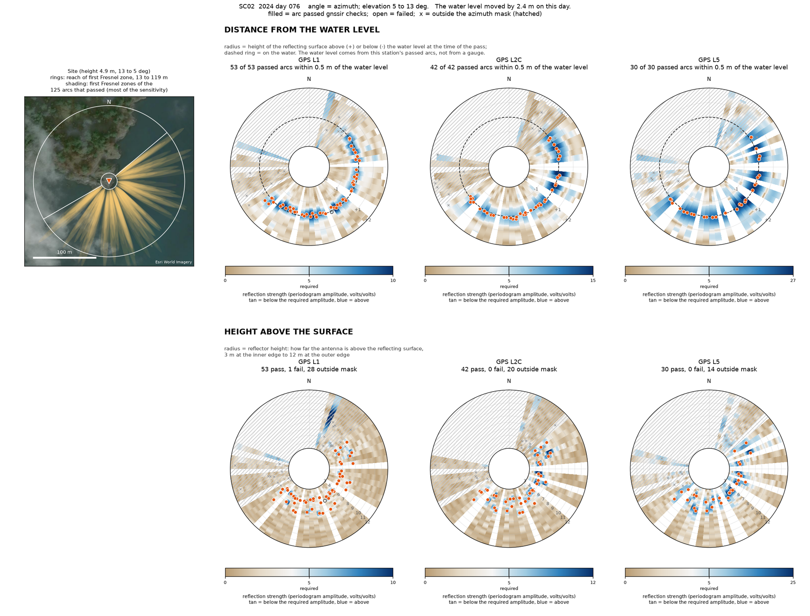
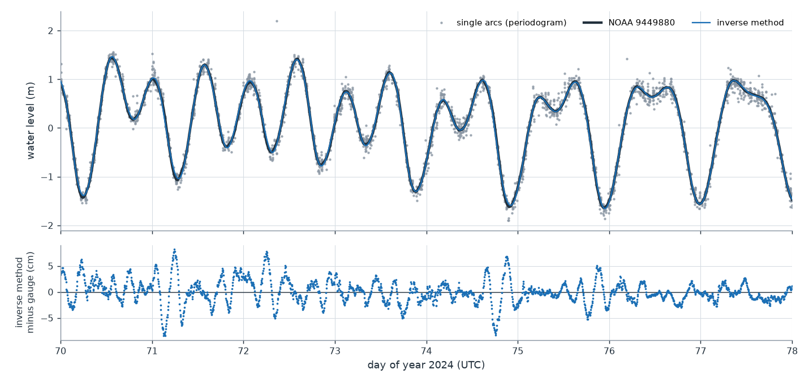

# GNSS-IR Processing Workflow

A Python workflow for water level from reflected GNSS signals (GNSS Interferometric Reflectometry). It downloads RINEX files, computes reflector heights with [gnssrefl](https://github.com/kristinemlarson/gnssrefl), compares them with a nearby gauge, and makes figures and a static results page.

The workflow is a wrapper around gnssrefl. gnssrefl is made for people who tune a station by hand. This repository adds one settings block per station, checks that need no expertise, and figures that show where the reflections come from. A typical use is a scheduled job that updates a station as new data arrive.

## What it does

1. **Download** RINEX 3 files (NPS GNSS archive, EarthScope, or NRCan).
2. **Translate** each day to a signal-strength (SNR) file with `rinex2snr`. gnssrefl 4 reads RINEX 3 directly.
3. **Heights** with `gnssir`: one reflector height per satellite arc.
4. **Reference**: find nearby gauges (USGS, NOAA CO-OPS, ERDDAP) and fetch their water level.
5. **Compare and plot**: time lag, correlation, time series.

Further tools, each one command:

| Command | What it gives |
|---|---|
| `python -m scripts.station_check` | Three checks: is the sampling fast enough, which L2 signal is in the file, and the scatter of the heights about a smooth curve (a quality measure that needs no gauge). |
| `python -m scripts.inverse_heights` | A smooth water level series every 5 minutes from the gnssrefl inverse method. In tests against gauges it was more precise than a spline through the single heights (GLBX: 4 cm against 10 cm; Friday Harbor: 1.8 cm against 2.6 cm; one month each, 2024). |
| `python -m scripts.visualizer.periodogram_circle` | Circular plot of the reflections by azimuth, next to an image of the site with the reflection zones. Two views: height above the surface, and distance from the water level. |
| `python -m scripts.station_page` | One static HTML page for a list of stations: circular plot, water level series, effect of the peak-to-noise limit, station checks. Example input: `docs/station_page_example.yaml`. |

## Example output

Friday Harbor, Washington (station SC02), March 2024. Data from EarthScope, gauge from NOAA.


*Where the reflections come from, for one day. Left: the site with the reflection zones of the arcs that passed. Top row: distance from the water level, where a reflection from the water lies on the dashed ring at any tide. Bottom row: height above the surface. Site image: USDA NAIP air photo, from USGS The National Map (public domain).*


*Water level for eight days. Grey points: one height per satellite arc. Blue: inverse method, a value every 5 minutes. Dark line: NOAA gauge 9449880. Below: inverse method minus gauge, 1.8 cm RMS over the month.*

## Setup

Python 3.10 or newer and gnssrefl 4.2.3 or newer.

```bash
conda create -n gnssrefl4 python=3.12
conda activate gnssrefl4
pip install gnssrefl
pip install -r requirements.txt
pip install contextily pyproj pillow   # for the site image in the circular plot
```

gnssrefl needs two environment variables. The workflow sets them for its own runs; set them yourself for the single commands in the table above.

- `REFL_CODE`: the gnssrefl workspace (station files in `input/`, SNR files, results)
- `ORBITS`: where gnssrefl stores orbit files

## Station settings

Stations are listed in `config/stations.yaml`, one short block each:

```yaml
GLBX:
  gnssrefl_json: config/glbx.json      # gnssrefl settings: position, elevation and height ranges, limits
  inverse_elevation: [2, 10]           # optional: wider elevation range for the inverse method
  reference: erddap:edu_ua_glos_obs_station_bartlett_cove_ak

SC02:
  gnssrefl_json: config/sc02.json
  data_source: earthscope              # nps (default), earthscope or nrcan
  reference: coops:9449880
```

`reference` is the gauge to compare with: `usgs:<site>`, `coops:<id>`, `coops:auto` (nearest NOAA gauge), `erddap:<dataset_id>` or `none`. Details of the references of a station (names, distances, datums) are in `config/references/<STATION>.json`. That file is written by:

```bash
python scripts/find_reference_stations.py --station GLBX --update-config
```

### Adding a station

1. Make the gnssrefl file with `gnssir_input` (see the gnssrefl documentation) and copy it to `config/<station>.json`.
2. Add a block to `config/stations.yaml`.
3. Run `find_reference_stations.py --station <STATION> --update-config`.
4. Process a week, then run `station_check` and the circular plot to judge the azimuth mask and the limits.

## Usage

```bash
# today's data (for a scheduled job)
python scripts/process_station.py --station GLBX --today

# the last 7 days
python scripts/process_station.py --station GLBX --days 7

# a period
python scripts/process_station.py --station GLBX --year 2024 --doy_start 60 --doy_end 91

# checks, inverse method and circular plot for the same period (REFL_CODE set)
python -m scripts.station_check --station glbx --year 2024 --doy 60 --doy_end 91 --rinex path/to/file.24o
python -m scripts.inverse_heights --station glbx --year 2024 --doy 60 --doy_end 91 --out glbx_inverse.csv
python -m scripts.visualizer.periodogram_circle --station glbx --year 2024 --doy 70
```

Flags of `process_station.py`: `--today`, `--days N`, `--validate` (check the settings and stop), `--skip_download`, `--skip_gnssir`, `--skip_comparison`, `--skip_viz`.

Results go to `results_annual/<STATION>/`: combined reflector heights, heights matched with the reference, and plots.

## Two rules for runs

Both come from how gnssrefl works. The workflow follows them; follow them too if you call gnssrefl yourself.

- **One `gnssir` job at a time per station.** `gnssir` unpacks and repacks the SNR file while it runs. Several jobs on one station at once lose days and can destroy an SNR file.
- **Translate first, then compute heights.** `gnssir` reads the SNR files of the neighbour days for arcs that cross midnight. If a neighbour day is not translated yet, those arcs are cut.

## What we learned about settings

From tests at three stations in 2024 (Gustavus AK, Friday Harbor WA, Fort Raleigh NC):

- Keep the refraction correction on. With no correction the heights have a scale error of 1.5% (elevation 5 to 13 degrees) to 4.7% (2 to 5 degrees).
- The peak-to-noise limit matters at stations with short arcs at very low elevation, and little at open stations. The station page shows its effect when a gauge exists.
- Slower sampling costs arcs before it costs precision. With arcs of about 10 minutes, 30 s data lose half the arcs.
- Check which L2 signal a file holds. A RINEX 3 to RINEX 2 conversion can put the weak legacy signal where the civil signal (L2C) is expected.
- For the inverse method, a wider elevation range removes gaps between arcs and improved the result.

## Testing

```bash
pytest
```

## Documentation

- [Installation](docs/INSTALL.md)
- [Worked example: Friday Harbor](docs/PROCESSING_EXAMPLE.md)
- [Parameters](docs/params_reference.md)
- [Methodology](docs/METHODOLOGY.md)
- [Architecture](docs/ARCHITECTURE.md)
- [Changelog](docs/CHANGELOG.md)

## Acknowledgments

- [gnssrefl](https://github.com/kristinemlarson/gnssrefl), the GNSS-IR processing package this workflow is built on
- [USGS Water Data](https://waterdata.usgs.gov/), [NOAA CO-OPS](https://tidesandcurrents.noaa.gov/), [NOAA NDBC](https://www.ndbc.noaa.gov/)
